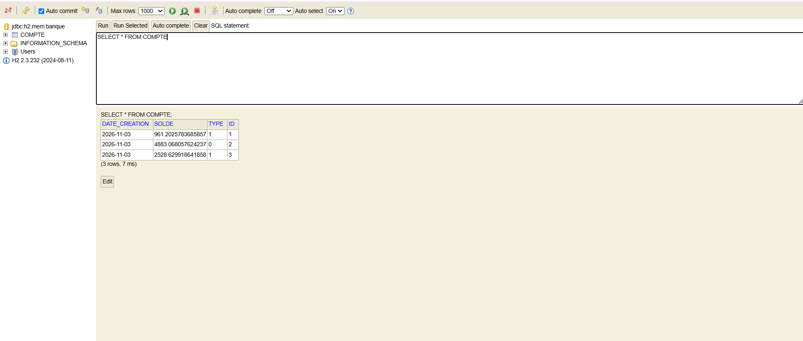
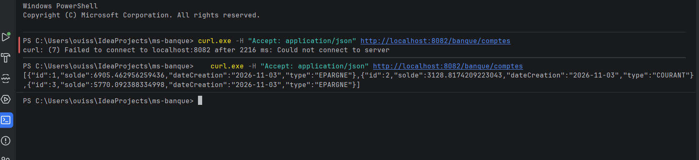
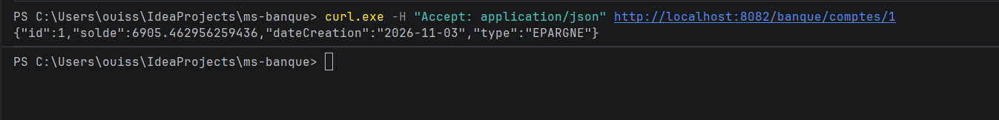
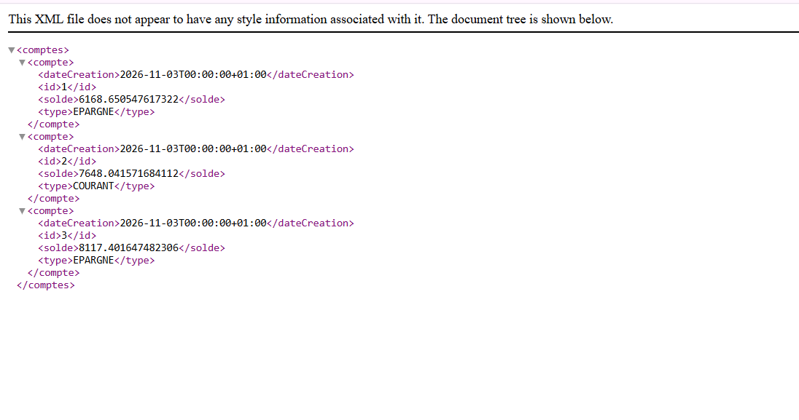
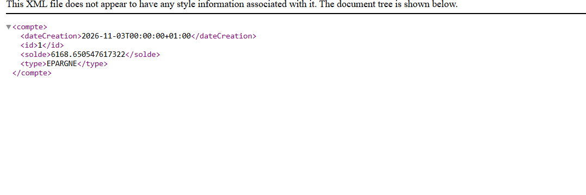

# TP — Service REST JAX-RS avec Spring Boot, Jersey et H2

## Objectif du TP

Développer un micro-service bancaire avec Spring Boot qui expose une API REST JAX-RS (Jersey) pour gérer des comptes bancaires stockés dans une base H2. Le service permet les opérations CRUD et renvoie les données en JSON ou en XML selon le format demandé par le client.

## Captures

**Console H2** : la table COMPTE avec les trois comptes créés au démarrage.

**Liste des comptes en JSON** : GET /banque/comptes renvoie tous les comptes en JSON.

**Un compte en JSON** : GET /banque/comptes/1 renvoie le compte numéro 1 en JSON.

**Liste des comptes en XML** : GET /banque/comptes renvoie tous les comptes en XML.

**Un compte en XML** : GET /banque/comptes/1 renvoie le compte numéro 1 en XML.

